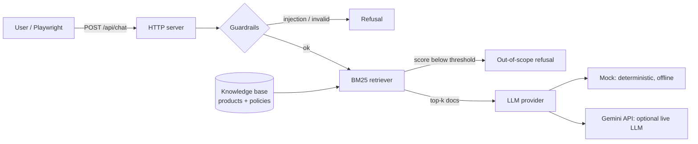

# AI Quality Lab

[](https://github.com/CarlosG-G/ai-quality-lab/actions/workflows/ci.yml)


**Quality engineering for AI, with AI.**

An LLM app is still software, so it needs real tests. But "the answer looks fine" is not a test.
This repo shows how I, as an SDET, approach both sides of the problem:

1. **Testing an AI app.** A small RAG support chatbot (*ShopBot*) is covered by unit, API contract and end-to-end tests, plus guardrail checks for prompt injection, out-of-scope questions and XSS.
2. **Using AI to test better.** A golden-dataset evaluation and LLM-as-a-judge quality gate run in CI.

Everything runs **offline and for free** by default, using a deterministic mock model. You can switch to a real model with one environment variable.

## What's inside



| Layer | What it checks | Where |
|---|---|---|
| Unit | Retrieval ranking, guardrails, bot logic (the model is never called for refused questions) | [`tests/unit`](tests/unit) |
| API contract | Status codes, payload shape, input validation, 413/405/404, security headers | [`tests/api`](tests/api) |
| End-to-end | Real browser chat flows, suggestion chips, multi-turn, injection refusal, XSS safety | [`tests/e2e`](tests/e2e) |
| Evals + AI judge | 17 golden cases check top-1 sources, expected facts and refusals; Copilot CLI with Gemini fallback adds a second opinion | [`evals`](evals) |
| Dashboard | Current evaluation, judge scores and per-case results published after pushes to `main` and weekly | [Public dashboard](https://carlosg-g.github.io/ai-quality-lab/) |

Design choices:

- **Zero runtime dependencies.** Node 24 runs TypeScript directly, so the app is plain `node src/server.ts`.
- **Provider abstraction.** The app uses one `LlmProvider` interface for the offline mock or Gemini API.
- **Deterministic by default.** CI never depends on a paid API or a flaky network call.
- **Page Object Model** for the UI tests ([`chat.page.ts`](tests/e2e/chat.page.ts)), so tests read as user intent.
- **Golden-dataset evals** produce a Markdown/JSON report with case-level failures and source, answer-fact, refusal and overall pass rates.
- **Independent LLM judge.** Copilot CLI scores answer correctness, groundedness, relevance and helpfulness, with Gemini as fallback; deterministic assertions remain the primary gate.

## Quick start

```bash
npm ci
npx playwright install chromium
npm test            # unit + API + E2E
npm run eval        # golden dataset; non-zero exit if a quality gate fails
npm run eval:judge  # rerun the dataset and judge answers with Copilot CLI / Gemini
npm run dashboard:build # build site/ from the latest evaluation report
npm start           # http://localhost:3000
```

The deterministic evaluator defaults to the offline mock. `npm run eval:judge` uses the Copilot CLI with the `fusion` model first. Locally, sign in with `copilot login`; GitHub Actions uses its built-in token with the `copilot-requests: write` permission. If Copilot is unavailable, the judge falls back to Gemini when `GEMINI_API_KEY` is configured. The same `.env` file can select `LLM_PROVIDER=gemini` to run the chatbot against a live Gemini model.

### Gemini API key setup (free-tier quick guide)

1. Sign in to [Google AI Studio](https://aistudio.google.com/) and open [API keys](https://aistudio.google.com/apikey).
2. Create a key for a project eligible for Gemini API free-tier access. New keys are authorization keys by default. Free-tier model access and quotas vary; check Google's [current pricing and free-tier table](https://ai.google.dev/gemini-api/docs/pricing).
3. Copy `.env.example` to `.env` and set `GEMINI_API_KEY=your-key` in `.env`. Do not paste the key into source files, commits, issues or chat. `.env` is ignored by Git; `.env.example` contains no secret.
4. Run `npm run eval:judge`. Copilot is tried first; the Gemini key is only used if Copilot fails.
5. To enable fallback on the public GitHub Actions workflow, add the key as a repository secret named `GEMINI_API_KEY` under **Settings → Secrets and variables → Actions**. The secret is not part of the public repository or downloadable files. Copilot CLI must also be allowed for the account or organization; if both providers are unavailable, the dashboard job fails explicitly.

The Gemini free tier may use submitted content to improve Google's products. This project sends only fictional product and support data, but do not use the free tier with private or confidential data.

Thresholds live in [`evals/thresholds.json`](evals/thresholds.json). The gates require at least 95% overall case pass rate, 95% top-1 source accuracy, 95% answer-fact rate, 100% refusal accuracy and 90% judge pass rate. A judge case passes with correctness, groundedness and relevance scores of at least 4/5, and helpfulness of at least 3/5. Judge output is an additional signal, not ground truth.

Reports are written to `reports/evaluation.json`, `reports/evaluation.md` and `reports/ai-judge.md`. The static dashboard is built to `site/`; GitHub Actions publishes it after a successful `main` run and once a week. Pull requests run deterministic checks but do not call the model or deploy Pages.

To run the chatbot against Gemini, set these values in `.env`:

```bash
LLM_PROVIDER=gemini
GEMINI_API_KEY=your-key
```

Then run `npm start`. The API key setup above explains how to create and protect the key.

## Roadmap

- [x] **Step 1:** ShopBot (RAG + guardrails), unit, API and E2E tests, CI
- [x] **Step 2:** Eval harness with golden dataset, metrics and CI quality gate
- [x] **Step 3:** LLM-as-a-judge (Copilot CLI → Gemini fallback) and a published quality dashboard
- [ ] **Step 4:** AI for testing: test generation from user stories and AI failure triage

## About

Built by [Carlos Gonzalez](https://www.linkedin.com/in/carlos-gonzalez-2b33b6241), an SDET focused on AI-driven quality engineering.
All data in this repo is fictional.
