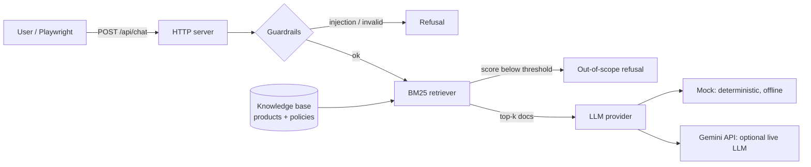

# AI Quality Lab

[](https://github.com/CarlosG-G/ai-quality-lab/actions/workflows/ci.yml)


**Quality engineering for AI, with AI.**

An LLM app is still software, so it needs real tests. But "the answer looks fine" is not a test.
This repo shows how I, as an SDET, approach both sides of the problem:

1. **Testing an AI app.** A small RAG support chatbot (*ShopBot*) is covered by unit, API contract and end-to-end tests, plus guardrail checks for prompt injection, out-of-scope questions and XSS.
2. **Using AI to test better.** A golden-dataset evaluation and LLM-as-a-judge quality gate run in CI.

Everything runs **offline and for free** by default, using a deterministic mock model. You can switch to a real model with one environment variable.

## What's inside



| Layer | What it checks | Where |
|---|---|---|
| Unit | Retrieval ranking, guardrails, bot logic (the model is never called for refused questions) | [`tests/unit`](tests/unit) |
| API contract | Status codes, payload shape, input validation, 413/405/404, security headers | [`tests/api`](tests/api) |
| End-to-end | Real browser chat flows, suggestion chips, multi-turn, injection refusal, XSS safety | [`tests/e2e`](tests/e2e) |
| Evals + AI judge | 17 golden cases check top-1 sources, expected facts and refusals; Copilot CLI with Gemini fallback adds a second opinion | [`evals`](evals) |
| Dashboard | Current evaluation, judge scores and per-case results published after pushes to `main` and weekly | [Public dashboard](https://carlosg-g.github.io/ai-quality-lab/) |

Design choices:

- **Zero runtime dependencies.** Node 24 runs TypeScript directly, so the app is plain `node src/server.ts`.
- **Provider abstraction.** The app uses one `LlmProvider` interface for the offline mock or Gemini API.
- **Deterministic by default.** CI never depends on a paid API or a flaky network call.
- **Page Object Model** for the UI tests ([`chat.page.ts`](tests/e2e/chat.page.ts)), so tests read as user intent.
- **Golden-dataset evals** produce a Markdown/JSON report with case-level failures and source, answer-fact, refusal and overall pass rates.
- **Independent LLM judge.** Copilot CLI scores answer correctness, groundedness, relevance and helpfulness, with Gemini as fallback; deterministic assertions remain the primary gate.

## Quick start

```bash
npm ci
npx playwright install chromium
npm test            # unit + API + E2E
npm run eval        # golden dataset; non-zero exit if a quality gate fails
npm run eval:judge  # rerun the dataset and judge answers with Copilot CLI / Gemini
npm run chaos:inject -- --seed 42 --mode mixed # inject one isolated bug and test whether the suite catches it
npm run chaos:campaign -- --runs 10 --seed 42 --mode mixed # measure mutation score across a reproducible campaign
npm run dashboard:build # build site/ from the latest evaluation report
npm run gemini:check    # verify every configured Gemini key and model (keys shown only as key#N)
npm start           # http://localhost:3000
```

### Chaos Lab · randomized bugs and detection

Chaos Lab copies the source, unit tests and golden evaluator into a temporary sandbox. It injects bugs only into that copy, runs typecheck + unit tests + golden evaluation, then removes the sandbox. The working tree and `main` are never deliberately modified by a campaign.

Two bug sources are available:

- **AST mutations** use a seeded random generator to change safe TypeScript expressions (comparators, logical/arithmetic operators and numeric constants). Type-invalid mutations are discarded.
- **Curated catalog** randomly selects realistic regressions in retrieval, prompt-injection guards and answer generation.

Examples:

```bash
npm run chaos:inject -- --seed 42 --mode catalog
npm run chaos:inject -- --seed 42 --mode mutation
npm run chaos:campaign -- --runs 20 --seed 42 --mode mixed
npm run chaos:heal -- --seed 42 --mode catalog
npm run chaos:campaign -- --runs 5 --seed 42 --mode mixed --heal
```

The same seed and mode reproduce the same sequence of bugs. Reports in `reports/chaos/`, `reports/chaos-summary.json` and `reports/chaos.md` record the injected patch, failed checks, detection time and mutation score. A surviving mutant means the current checks did not expose that bug; it is reported rather than silently counted as a pass. Invalid (non-compiling) mutants are excluded from the score.

The dashboard includes detection and healing metrics, diagnoses and both patches. CI runs a small isolated campaign with autoheal before publishing the dashboard. The separate **Chaos Lab** workflow can be run manually with a chosen seed, mode, run count and optional healing; it also runs weekly.

Autoheal is deliberately blind: it receives only failing-check output and the current source, not the injected bug id or patch. Copilot CLI (`fusion` with the `hydrafusion` auto tier, i.e. Fusion High) is tried first with tools disabled; Gemini is the fallback. Fusion requests enable the CLI's `DYNAMIC_AUTO_TIERS` feature flag for headless compatibility and send the prompt through stdin. Set `COPILOT_FUSION_TIER` to choose another tier; if the account cannot use it, the call is retried once with the CLI default tier. The response is structured JSON with exact search-and-replace edits. Only the five listed `src/**` files are editable; tests, evaluations and configuration are checksum-protected. Each repair is followed by typecheck, unit tests and the golden evaluation, for up to three attempts. Provider startup failures stop retries immediately. Reports distinguish `healed-exact`, `healed-equivalent`, `partial`, `failed` and `not-needed`. Campaigns with `--heal` are limited to five bugs to control runtime and model usage.

Set `HEAL_PROVIDER=auto|copilot|gemini` in `.env`; `auto` is the default. Gemini uses the shared key rotation and model fallback settings, so a heal can consume free-tier requests when Copilot is unavailable.

The deterministic evaluator defaults to the offline mock. `npm run eval:judge` uses the Copilot CLI with the `fusion` model first. Locally, sign in with `copilot login`; GitHub Actions uses its built-in token with the `copilot-requests: write` permission. If Copilot is unavailable, the judge falls back to Gemini when `GEMINI_API_KEY` is configured. The same `.env` file can select `LLM_PROVIDER=gemini` to run the chatbot against a live Gemini model.

### Gemini API key setup (free-tier quick guide)

1. Sign in to [Google AI Studio](https://aistudio.google.com/) and open [API keys](https://aistudio.google.com/apikey).
2. Create a key for a project eligible for Gemini API free-tier access. New keys are authorization keys by default. Free-tier model access and quotas vary; check Google's [current pricing and free-tier table](https://ai.google.dev/gemini-api/docs/pricing).
3. Copy `.env.example` to `.env` and set `GEMINI_API_KEY=your-key` in `.env`. Do not paste the key into source files, commits, issues or chat. `.env` is ignored by Git; `.env.example` contains no secret.
4. Run `npm run gemini:check` to confirm the key works, then `npm run eval:judge`. Copilot is tried first; the Gemini key is only used if Copilot fails. Set `JUDGE_PROVIDER=gemini` to test the Gemini judge directly.
5. To enable fallback on the public GitHub Actions workflow, add the key as a repository secret named `GEMINI_API_KEY` under **Settings → Secrets and variables → Actions**. The secret is not part of the public repository or downloadable files. Copilot CLI must also be allowed for the account or organization; if both providers are unavailable, the dashboard job fails explicitly.

The Gemini free tier may use submitted content to improve Google's products. This project sends only fictional product and support data, but do not use the free tier with private or confidential data.

The shared Gemini client ([`src/providers/gemini-client.ts`](src/providers/gemini-client.ts)) is built for free-tier limits:

- **Key rotation.** `GEMINI_API_KEYS="key1,key2"` moves to the next key when one runs out of quota or is rejected.
- **Model fallback.** `GEMINI_MODELS` / `GEMINI_JUDGE_MODELS` list models in order; overloaded (503) or missing models are skipped.
- **Rate-limit aware.** It honours Gemini's `RetryInfo` delay, parks a rate-limited model/key pair for later requests, and fails fast when the daily quota is exhausted instead of waiting.
- **Safe output.** Safety blocks fail immediately, thinking parts are dropped, the judge uses a JSON response schema, and keys travel only in the `x-goog-api-key` header, never in URLs, logs or errors.

Free-tier quotas are small (for example 20 requests per day per model), so one live `eval` plus judge run can use most of a key's daily budget. If a provider fails mid-run, the evaluator stops with exit code 2 and keeps the previous report.

Thresholds live in [`evals/thresholds.json`](evals/thresholds.json). The gates require at least 95% overall case pass rate, 95% top-1 source accuracy, 95% answer-fact rate, 100% refusal accuracy and 90% judge pass rate. A judge case passes with correctness, groundedness and relevance scores of at least 4/5, and helpfulness of at least 3/5. Judge output is an additional signal, not ground truth.

Reports are written to `reports/evaluation.json`, `reports/evaluation.md` and `reports/ai-judge.md`. The static dashboard is built to `site/`; GitHub Actions publishes it after a successful `main` run and once a week. Pull requests run deterministic checks but do not call the model or deploy Pages.

To run the chatbot against Gemini, set these values in `.env`:

```bash
LLM_PROVIDER=gemini
GEMINI_API_KEY=your-key
# optional: GEMINI_API_KEYS=key1,key2 and GEMINI_MODELS=gemini-3.8-flash,gemini-3.6-flash
```

Then run `npm start`. The API key setup above explains how to create and protect the key.

## Testing vocabulary (ISTQB)

The code and reports use standard ISTQB terms:

| Term | Where it appears |
|---|---|
| **Test oracle** | Golden dataset expectations (`evals/dataset.json`) and the original source when judging an exact heal |
| **Exit criteria / quality gates** | `evals/thresholds.json`; CI fails when any gate is not met |
| **Component testing** | `tests/unit` (Playwright test runner, no browser) |
| **System testing** | `tests/api` and `tests/e2e` against the running app |
| **Defect (fault) seeding** | Chaos Lab injects known faults into a sandbox copy |
| **Mutation testing** | AST mutants; a *killed* mutant is a detected fault, a *survived* mutant shows a test gap |
| **Mutation score** | Killed mutants ? valid (compiling) mutants |
| **Failure vs defect** | A failing check is the failure; the seeded code change is the defect |
| **Confirmation testing** | Re-running the checks after each autoheal repair |
| **Regression testing** | The full unit + evaluation suite re-run on every repair, not only the failing check |

## Roadmap

- [x] **Step 1:** ShopBot (RAG + guardrails), unit, API and E2E tests, CI
- [x] **Step 2:** Eval harness with golden dataset, metrics and CI quality gate
- [x] **Step 3:** LLM-as-a-judge (Copilot CLI → Gemini fallback) and a published quality dashboard
- [x] **Step 4:** Chaos Lab: reproducible bug injection, test detection and mutation-score dashboard
- [x] **Step 5:** AI autoheal: blind diagnosis, guarded source-only patches and re-validation
- [ ] **Step 6:** AI for testing: test generation from user stories and AI failure triage

## About

Built by [Carlos Gonzalez](https://www.linkedin.com/in/carlos-gonzalez-2b33b6241), an SDET focused on AI-driven quality engineering.
All data in this repo is fictional.
