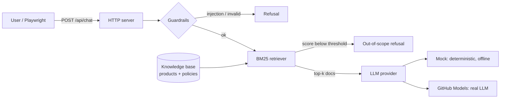

# AI Quality Lab

[](https://github.com/CarlosG-G/ai-quality-lab/actions/workflows/ci.yml)


**Quality engineering for AI, with AI.**

An LLM app is still software, so it needs real tests. But "the answer looks fine" is not a test.
This repo shows how I, as an SDET, approach both sides of the problem:

1. **Testing an AI app.** A small RAG support chatbot (*ShopBot*) is covered by unit, API contract and end-to-end tests, plus guardrail checks for prompt injection, out-of-scope questions and XSS.
2. **Using AI to test better.** *(in progress)* An eval harness with a golden dataset and LLM-as-a-judge that runs as a quality gate in CI, and AI helpers for test generation and failure triage.

Everything runs **offline and for free** by default, using a deterministic mock model. You can switch to a real model with one environment variable.

## What's inside



| Layer | What it checks | Where |
|---|---|---|
| Unit | Retrieval ranking, guardrails, bot logic (the model is never called for refused questions) | [`tests/unit`](tests/unit) |
| API contract | Status codes, payload shape, input validation, 413/405/404, security headers | [`tests/api`](tests/api) |
| End-to-end | Real browser chat flows, suggestion chips, multi-turn, injection refusal, XSS safety | [`tests/e2e`](tests/e2e) |
| Evals *(next)* | Answer correctness, groundedness and refusals on a golden dataset, gated in CI | `evals/` |

Design choices:

- **Zero runtime dependencies.** Node 24 runs TypeScript directly, so the app is plain `node src/server.ts`.
- **Provider abstraction.** Tests and evals run against the same `LlmProvider` interface, so the same suite can check a mock, GitHub Models or any other backend.
- **Deterministic by default.** CI never depends on a paid API or a flaky network call.
- **Page Object Model** for the UI tests ([`chat.page.ts`](tests/e2e/chat.page.ts)), so tests read as user intent.

## Quick start

```bash
npm ci
npx playwright install chromium
npm test            # unit + API + E2E
npm start           # http://localhost:3000
```

Run against a real model (free with GitHub Models):

```bash
# a fine-grained token with "Models: read" permission
LLM_PROVIDER=github-models GITHUB_TOKEN=<token> npm start
```

## Roadmap

- [x] **Step 1:** ShopBot (RAG + guardrails), unit, API and E2E tests, CI
- [ ] **Step 2:** Eval harness with golden dataset, metrics and CI quality gate
- [ ] **Step 3:** LLM-as-a-judge (GitHub Models) and a published quality dashboard
- [ ] **Step 4:** AI for testing: test generation from user stories and AI failure triage

## About

Built by [Carlos Gonzalez](https://www.linkedin.com/in/carlos-gonzalez-2b33b6241), an SDET focused on AI-driven quality engineering.
All data in this repo is fictional.
